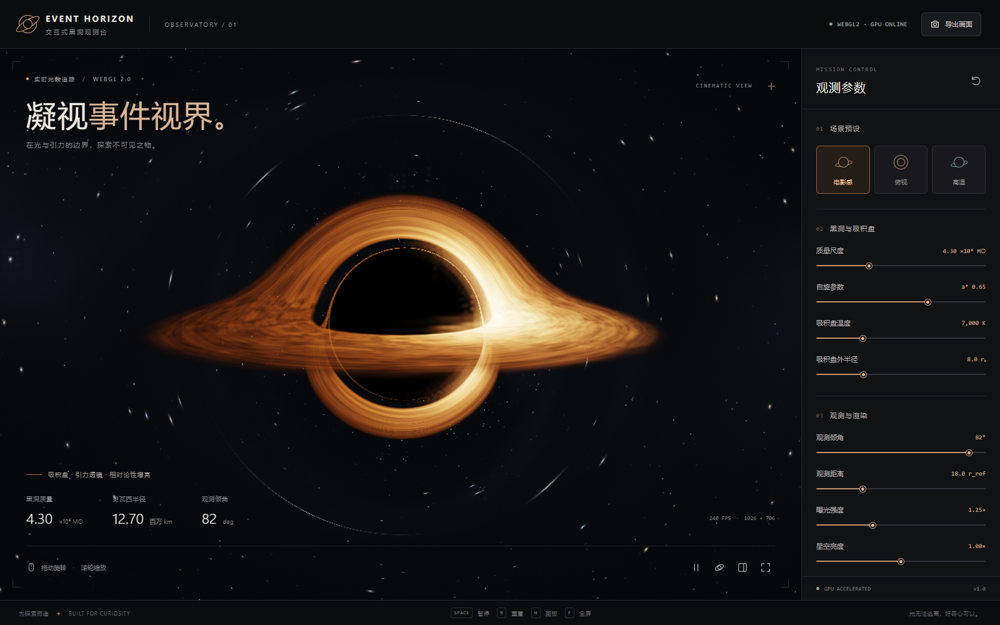
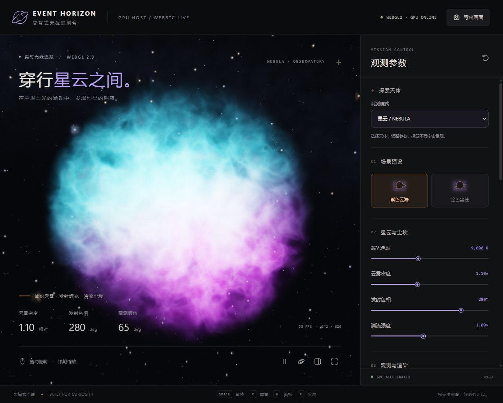
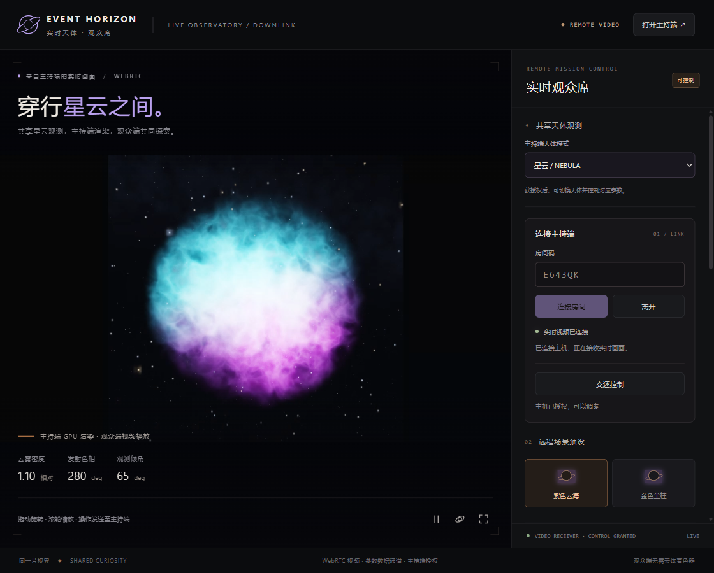
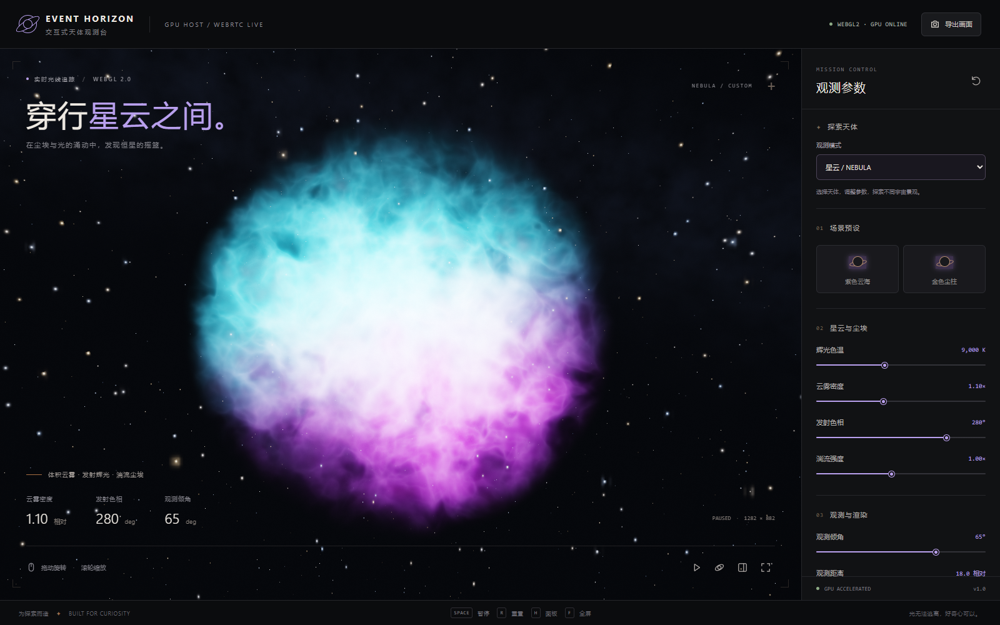
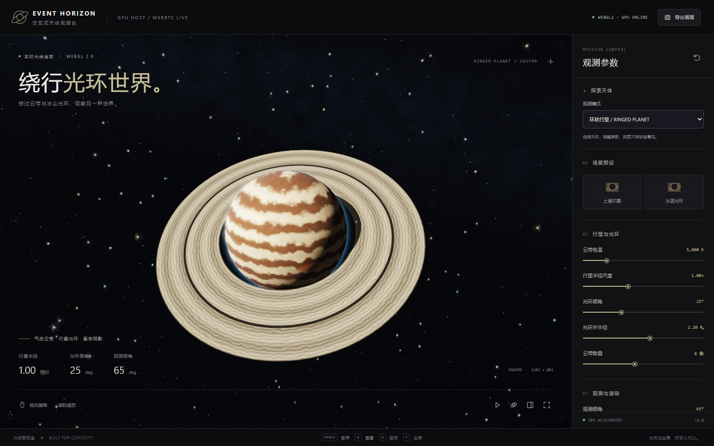
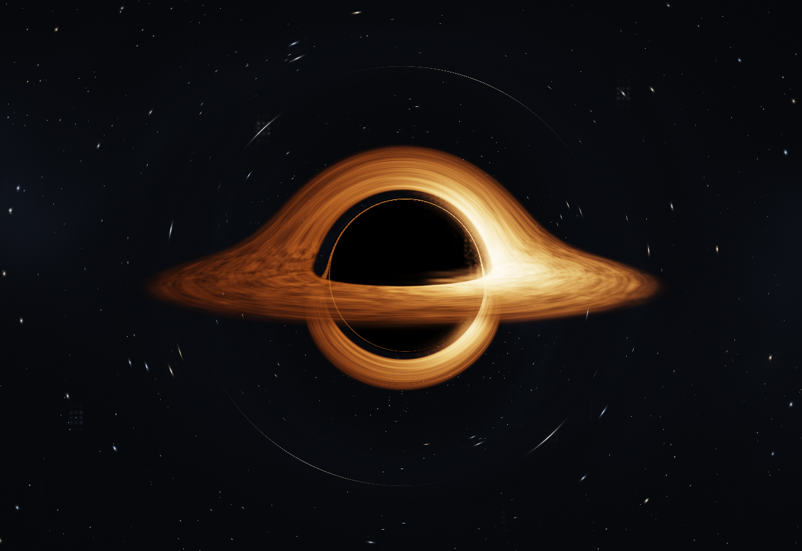

# Event Horizon · GPU 天体观测与 WebRTC 交互直播

### 在光与引力的边界，探索不可见之物。

一个可以在浏览器中实时探索的天体观测台。五种模式涵盖黑洞、星云、旋涡星系、带环行星与恒星；GPU 实时生成天体画面，通过参数面板和轨道相机观察不同形态、视角和渲染设置。黑洞模式保留弯曲光线、吸积盘与引力透镜的原有体验。

**WebGL 2 · WebRTC 视频 · 数据通道调参 · 实际传输统计 · MIT**

Chrome 主持端负责 GPU 渲染，Edge 观众端接收视频并申请远程控制。五种模式及其专属参数都可以在直播中切换，所有观众看到同一主持端画面。仓库包含完整程序、自动化测试和实际运行截图。详细的课程映射、信令流程与实验说明见 [WebRTC 实验指南](docs/WEBRTC.md)。



> A browser-based GPU celestial observatory featuring black holes, nebulae, spiral galaxies, ringed planets and stars, with interactive controls, PNG/configuration export and WebRTC viewing. These are illustrative procedural models, not research-grade astronomical simulations.

## 快速开始

需要 **Node.js 20 或更高版本**，以及支持 WebGL 2 的现代 Chrome、Edge 或 Firefox。浏览器应允许图形加速。

```bash
git clone https://github.com/realhc/event-horizon.git
cd event-horizon
npm ci
npm start
```

打开 [http://127.0.0.1:5173](http://127.0.0.1:5173)。服务默认只监听本机；端口占用时可执行 `npm start -- --port 5180`，也支持 `PORT` 环境变量。WebSocket 信令新增运行依赖 `ws`，启动前需要执行 `npm ci`。Windows 用户也可以运行 `start.cmd`。请通过 HTTP 服务打开页面，而不是直接双击 `index.html`。

在项目目录安装依赖后，运行 `npm run demo:live` 或双击 `start-live.cmd`，会在端口 **5180** 启动服务，打开独立 Chrome 和 Edge 窗口，自动连接并验证视频、授权与远程操作。关闭两个演示窗口会关闭该演示服务；也可在启动终端按 `Ctrl+C`。需要已安装 Chrome、Edge，以及 `npm ci` 安装的开发依赖。手动服务、演示与完整验收应分别启动，避免同时占用同一端口。

```bash
npm run dev    # 启动开发用静态服务
npm run build  # 生成 dist/ 静态站点
npm run preview # 本地预览 dist/ 构建结果
npm test       # 运行自动化测试
npm run check  # 检查 JavaScript 语法、测试和构建
npm run demo:live # 启动 Chrome 主持端 + Edge 观众端
npm run test:live # 在真实 Chrome/Edge 中自动验证完整直播流程
```

构建结果保留相对资源路径并包含观众页。本地渲染可以使用静态文件服务；直播还需要 Node WebSocket 信令服务，可执行 `npm run preview`。GPU 渲染发生在主持端浏览器；观众端只播放收到的视频，不运行天体着色器。

## 本机直播实验

1. 主持端点击「开始直播」，在 Edge 观众页输入房间码连接。
2. 观众点击「申请参数控制」，主持端允许后即可选择天体模式、调节该模式的参数、切换预设、暂停和拖动视角。
3. 主持端选择 720p/1080p、30/60 FPS 和目标码率上限，观察实际视频分辨率、码率、帧率、丢包和网络 RTT。
4. 点击「导出实验统计 CSV」保存真实采样，供课程报告对比。RTT 不代表完整画面延迟；浏览器未报告的字段保留为空。

每个房间支持一名主持端和最多七名观众，同时只有一名观众持有控制权。视频轨道不采集摄像头、麦克风或桌面，仅来自天体画布。切换模式会继续使用同一视频轨道，不需要重建房间。当前信令限定本机回环地址，没有公网 STUN/TURN 服务。




## 可以探索什么

| 天体模式 | 画面与专属控制 |
| --- | --- |
| 黑洞 `blackHole` | 黑洞阴影、弯曲光线与吸积盘；质量、自旋、温度、盘半径及引力透镜等开关 |
| 星云 `nebula` | 程序化云气与发光结构；云气密度、色相和湍流尺度 |
| 旋涡星系 `galaxy` | 旋臂、核心、星点与尘埃；旋臂数量、卷曲程度和尘埃强度 |
| 带环行星 `planet` | 球体表面条带与行星环；半径、环倾角、环宽度和条带数量 |
| 恒星 `star` | 发光星球表面与日冕；温度、活动强度和日冕范围 |

- **自由观测**：拖动旋转视角，滚轮改变相机距离；每种模式都有适合自身画面的预设。
- **模式对应面板**：选择天体后只显示相关专属参数；相机、曝光、星空、速度与质量由五种模式共享。
- **渲染控制**：三档质量、曝光、星空强度、动画速度，以及暂停、全屏、隐藏参数面板。
- **保存结果**：导出当前画面为 PNG；导出和导入 JSON 参数配置。
- **运行信息**：显示实际渲染分辨率、帧率与可获取的渲染设备信息。





截图来自程序实际运行画面。PNG 导出保存当前天体画布，页面截图则包含界面和参数面板。使用 `npm run capture:celestial` 可以重新生成五种模式的界面截图与纯画面截图。

## 参数说明

下表前六项是黑洞参数或相机参数。所有模式共用倾角、方位、距离、曝光、星空强度、动画速度和渲染质量；温度表示黑洞吸积盘或恒星光球的近似色温，在星云、星系与行星模式中用于辉光、星光或云带配色。黑洞的 `massScale`、`spin`、`diskOuter` 和三项效果开关只对黑洞画面生效。其他天体的距离是相对观察尺度，不使用黑洞的史瓦西半径作物理标定。

默认电影感预设：质量尺度 `1`、自旋 `0.65`、倾角 `82°`、方位 `0.22 rad`、距离 `18 r_ref`、温度 `7,000 K`、吸积盘外半径 `8 rₛ`、曝光 `1.25`、星空强度 `1`、动画速度 `0.7`，使用均衡质量。

| 参数 | 范围 | 作用 |
| --- | --- | --- |
| 质量尺度 `massScale` | 0.65–1.80 | 改变黑洞与场景的相对尺度，并更新质量、史瓦西半径读数 |
| 自旋 `spin` | 0–0.98 | 改变盘面内缘、运动，并加入微弱的艺术化光线拖拽项 |
| 倾角 `inclination` | 5–89° | 从接近俯视到接近侧视观察吸积盘 |
| 方位 `yaw` | −π–π | 水平拖动控制的相机方位角，单位为弧度 |
| 观测距离 `distance` | 10–40 | 相机距离，以默认质量对应的参考史瓦西半径为单位；滚轮可调 |
| 温度 `temperature` | 3,000–18,000 K | 改变盘面的近似热辐射配色 |
| 吸积盘外半径 `diskOuter` | 5–16 | 发光盘外边界，以当前质量对应的史瓦西半径为单位 |
| 曝光 `exposure` | 0.4–3.0 | 调整最终画面亮度 |
| 星空强度 `stars` | 0–2 | 调整背景星空亮度 |
| 动画速度 `speed` | 0–2 | 改变吸积盘纹理动画的速度 |

| 模式专属参数 | 范围 | 作用 |
| --- | --- | --- |
| 星云密度 `nebulaDensity` | 0.2–2.5 | 云气的浓度与发光强度 |
| 星云色相 `nebulaHue` | 0–360° | 云气的主要色调 |
| 星云湍流 `nebulaTurbulence` | 0.2–2 | 云气细节与结构变化 |
| 旋臂数量 `galaxyArms` | 2–6 | 星系的旋臂数量 |
| 旋臂卷曲 `galaxyPitch` | 0.15–0.8 | 旋臂的卷曲形态 |
| 星系尘埃 `galaxyDust` | 0–2 | 尘埃条带的视觉强度 |
| 行星半径 `planetRadius` | 0.65–1.6 | 球体相对尺度 |
| 行星环倾角 `ringTilt` | 0–80° | 环面相对倾斜角 |
| 行星环宽度 `ringWidth` | 1.2–3 | 环的外沿相对尺度 |
| 表面条带 `planetBands` | 2–16 | 行星表面条带数量 |
| 恒星活动 `starActivity` | 0.1–2 | 表面活动与周围发光变化 |
| 日冕范围 `starCorona` | 0.2–2 | 日冕的相对扩展范围 |

光线积分坐标以当前史瓦西半径 `rₛ` 归一化；相机在该坐标中的距离是 `distance / massScale`，因此增加质量尺度会让黑洞在固定参考视距下看起来更大。温度配色、吸积盘尺寸与时间速度不构成真实天体的定量标定。

| 操作 | 快捷方式 |
| --- | --- |
| 改变方位和倾角 | 在画面上拖动 |
| 改变观测距离 | 滚轮 |
| 暂停 / 继续动画 | `Space` |
| 恢复当前天体的默认参数 | `R` |
| 显示 / 隐藏参数面板 | `H` |
| 进入 / 退出画面全屏 | `F` |

也可以使用界面按钮完成这些操作。重置相机只恢复当前天体的观测角度和距离；重置全部参数保留当前天体模式，恢复该模式的默认设置。启用系统「减少动态效果」偏好时，程序初始暂停动画；参数调整仍会刷新画面，可以手动继续。参数配置采用版本化 JSON，包含 `parameters.scene` 与天体参数；导入时会检查类型和范围。没有 `scene` 字段的旧版 `version: 1` 配置按黑洞模式载入，仍然兼容原项目的配置文件。

## GPU 与性能

渲染器使用 WebGL 2 的全屏片元着色器，按当前天体选择对应程序化绘制路径，再通过 GPU 泛光与色调映射合成画面。黑洞路径独立推进光线，检测是否被捕获、穿过吸积盘或逃逸到背景；其他模式生成云气、旋臂、球体、行星环与恒星发光结构。JavaScript 负责相机、参数、时间和界面。画面无需预先生成的天体视频或贴图。

浏览器和驱动决定 WebGL 使用的设备。支持时，界面读取 `WEBGL_debug_renderer_info` 显示渲染器名称；如果浏览器出于隐私原因隐藏该信息，设备名称可能不可用，不能据此断言使用了独立显卡。软件渲染器也可能提供 WebGL 2，此时性能会明显降低。

遇到低帧率时：

1. 将渲染质量切换为「流畅」，或缩小浏览器窗口。
2. 在浏览器设置中启用可用的图形 / 硬件加速，重新启动浏览器。
3. 检查显卡驱动与浏览器的 WebGL 状态；Chrome 可打开 `chrome://gpu`，Edge 可打开 `edge://gpu`。

帧率取决于 GPU、窗口尺寸、设备像素比、浏览器与所选质量；项目不承诺固定 FPS。右下角显示的是浏览器动画帧率估计，不是 GPU 时间查询。

## 模型与边界

这是用于探索和视觉演示的**近似模型**。它以受 Schwarzschild 光线路径启发的中心加速度数值推进光线，累计多次盘面交叉的辐射来表现引力透镜和盘面多重影像。吸积盘使用程序纹理、近似热辐射配色与亮度模型；自旋改变盘面表现并加入微弱的艺术化拖拽项，没有实现完整 Kerr 度规、精确测地线或科学级辐射转移。光子环微光、泛光与色调处理也包含视觉增强。

新增四种天体同样采用程序化视觉模型。星云颜色并非真实光谱线测量，旋涡星系没有执行 N 体引力模拟，行星表面与环没有对应具体天体的测绘数据，恒星活动与日冕也没有求解磁流体方程。参数服务于实时观察与多媒体交互，不能用于推算真实天体的距离、质量或演化。

质量读数采用 `M = 4.3 × 10⁶ × massScale M☉`，并以 `rₛ = 2GM/c²` 计算史瓦西半径。默认约为 **4.3 百万太阳质量**与 **1,270 万千米**。这个读数用于给相对尺度提供直观参考；它不意味着相机、盘面尺寸、温度或时间已与某个真实黑洞建立一致的物理标定。自旋变化也不会将这条史瓦西半径公式转换成旋转黑洞的真实事件视界半径。

进一步了解：

- [NASA：Black Hole Accretion Disk Visualization](https://svs.gsfc.nasa.gov/13326/) — 黑洞引力如何改变吸积盘的可见形状与亮度。
- [Khronos：WebGL 2.0 Specification](https://registry.khronos.org/webgl/specs/latest/2.0/) — 浏览器图形 API 的规范。

这些是概念和技术参考；项目源码与截图由本项目生成。

## 项目结构

```text
event-horizon/
├── index.html                 # 观测台界面
├── src/
│   ├── main.js                # 参数面板、相机交互、导入导出、快捷键
│   ├── params.js              # 五种天体的默认参数、范围、预设与配置校验
│   ├── renderer.js            # WebGL 初始化、尺寸管理与渲染生命周期
│   ├── shaders.js             # GLSL 五种天体、光线积分和星空
│   ├── viewer.js              # 视频接收与授权后的跨模式控制
│   ├── session.js             # WebRTC 视频、信令和数据通道
│   └── style.css              # 界面与响应式布局
├── public/favicon.svg
├── docs/screenshots/          # 程序实际截图
├── tests/                     # 自动化测试
├── scripts/
│   ├── server.mjs             # Node 静态服务与 WebSocket 信令
│   ├── build.mjs              # 静态构建
│   ├── capture.mjs            # 重新生成原黑洞截图
│   └── capture-celestial.mjs  # 五种天体的真实浏览器截图
├── package.json
└── LICENSE
```

前端采用原生 ES modules、HTML 和 CSS；黑洞 GLSL 着色器在 `src/shaders.js`，其他天体的体积与表面着色器在 `src/celestial-shaders.js`，可直接研究或修改。恒星色温采用黑体近似与艺术化暖色至蓝色调色，以保留光球纹理。

## 开发与验证

`npm test` 使用 Node 内置测试运行器检查 HTTP 服务、信令房间与权限、资源清理、路径边界、静态构建、参数配置校验与物理读数。`npm run check` 进一步检查 JavaScript 语法并执行测试和构建；需先安装依赖。`npm run test:live` 验证 Chrome → Edge 的真实 WebRTC 视频、跨天体模式控制、主持端状态同步与授权撤回，生成 `qa-output/` 报告和实际直播截图。

浏览器渲染测试和截图工具是可选的，需要先安装锁定的开发依赖，并在电脑上安装 Chrome：

```bash
npm ci
npm run test:gpu
npm run capture
npm run capture:celestial
```

`test:gpu` 使用真实浏览器检查五种天体都能生成有内容且不同的画面、专属参数在暂停状态下刷新 GPU 画面、当前模式重置及 JSON 往返兼容。`capture` 保留原黑洞截图流程，`capture:celestial` 生成五种模式的真实运行截图。工具使用已安装的浏览器，不要求另行下载 Playwright Chromium。使用 Edge 时，在 PowerShell 中先执行 `$env:PLAYWRIGHT_CHANNEL = 'msedge'`，再运行对应命令。浏览器测试通过只能确认当前设备上的功能；是否使用硬件 GPU 仍以实际渲染器信息为准。

## License

[MIT](LICENSE) · Copyright © 2026 Hong Chang
