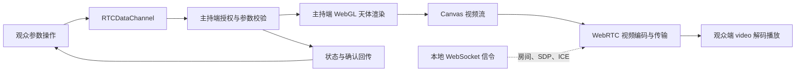

# Event Horizon · WebRTC 实时天体观测实验

主持端使用 WebGL 2 渲染黑洞、星云、旋涡星系、带环行星或恒星，通过 WebRTC 发送当前天体画布的视频流。观众端打开 `viewer.html` 接收视频，申请控制后可以通过数据通道切换模式和修改主持端参数。观众端不加载天体渲染器，也不创建 WebGL 上下文。

这一版面向 **Windows 同一台电脑上的两个浏览器**：Chrome 作为主持端、Edge 作为观众端。使用独立浏览器可以直观验证视频与参数确实跨浏览器传输。完整实现、测试和运行截图包含在仓库中。

## 启动与连接

需要 Node.js 20 或更高版本，以及已安装的现代 Chrome 和 Edge。WebSocket 信令服务新增运行依赖，因此首次启动需要安装依赖：

```powershell
cd E:\CodexSandbox\Projects\event-horizon
npm ci
npm start -- --port 5180
```

`5180` 用于避免与已有的 `5173` 静态预览进程冲突；也可以选择其他空闲端口。主持端和观众端必须使用同一个服务地址和端口。

也可以直接执行 `npm run demo:live`，或双击项目根目录的 `start-live.cmd`。工具会启动本机服务、打开 Chrome 与 Edge 两个窗口，并自动连接、申请授权、验证调参。关闭两个演示窗口或按 `Ctrl+C` 会结束该演示服务。自动化完整验收使用 `npm run test:live`，报告与实验 CSV 存于 `qa-output/`，真实截图存于 `docs/screenshots/webrtc-host.png` 和 `webrtc-viewer.png`。

1. 在 Chrome 打开 [主持端](http://127.0.0.1:5180/)，在实时会话面板创建房间。
2. 在 Edge 打开 [观众端](http://127.0.0.1:5180/viewer.html)，输入主持端显示的房间码，点击「连接房间」。
3. 等待视频连接。观众端将显示视频分辨率和传输指标；如果自动播放被浏览器拒绝，点击画面中央的播放按钮。
4. 观众点击「申请参数控制」，主持端决定是否授权。获授权后，天体选择、参数滑块、预设和相机操作才能发送至主持端。
5. 观众可以「交还控制」或「离开」。主持端停止房间后，观众的视频与控制权限清除；重新连接需要再次点击「连接房间」。

也可以用链接预填房间码：`http://127.0.0.1:5180/viewer.html?room=房间码`。加上 `&auto=1` 会自动加入房间，适合本地演示启动工具；普通观众链接保留手动连接。

## 可以远程控制什么

授权后的观众可以选择五种天体模式。主持端切换模式也会更新每位观众的模式名称、专属面板、读数和参数；切换继续使用现有视频轨道与数据通道，无需退出或重建房间。

| 模式 | 可以控制的专属参数 |
| --- | --- |
| 黑洞 `blackHole` | 质量尺度、自旋、温度、吸积盘半径、引力透镜、多普勒增亮和吸积盘开关 |
| 星云 `nebula` | 云气密度、色相、湍流结构 |
| 旋涡星系 `galaxy` | 旋臂数量、卷曲程度、尘埃强度 |
| 带环行星 `planet` | 半径、环倾角、环宽度、表面条带数量 |
| 恒星 `star` | 温度、活动强度、日冕范围 |

所有模式共用倾角、距离、曝光、星空强度、动画速度与主持端渲染质量。画面中拖动还能改变方位角。非黑洞模式的读数用于描述当前视觉参数，不沿用黑洞的质量和史瓦西半径；这些程序化画面没有具体天体的物理标定。

拖动视频画面改变相机方位与倾角，滚轮调整距离。暂停、重置相机与当前模式的场景预设也通过数据通道发送。重置相机恢复当前模式的观测角度和距离；主持端「重置全部参数」保留模式，恢复该模式默认设置。连续滑块和相机操作合并后约每 33 ms 发送一次，结束拖动时立即发送最后的变化；主持端确认的状态会回传并更新观众端。未授权或控制被撤回后，模式选择与专属参数均为只读，观众仍然可以观看视频与指标，并可独立全屏播放。

暂停控制暂停的是主持端当前天体的动画。暂停后仍可调参或切换模式，GPU 会绘制更新后的静态画面。WebRTC 连接继续存在；实际收到多少帧取决于画布捕获与浏览器行为，不能将静止画面直接理解为断线。

## 视频与控制路径



Node 服务负责静态文件与 WebSocket 信令，信令用于建立房间和交换连接信息。天体视频通过 `RTCPeerConnection` 传输，模式与参数操作通过 `RTCDataChannel` 传输。主持端对模式名称、参数类型与范围进行校验，并将确认后的完整状态回传。视频编码、解码和码率控制由浏览器处理；JavaScript 不使用逐帧截图上传代替视频传输。

采集画布可以选择 1280×720 或 1920×1080，保留天体源画布的比例并补边。发送端优先保持分辨率，在支持时优先协商 H.264，并保留其他编码格式作为回退。当前实验没有音轨。输出视频尺寸不等于源着色器渲染分辨率，源画布较小时输出会放大。目标码率是上限，实际码率由场景复杂度、浏览器和连接情况共同决定。星云、星系、行星与恒星的细节和运动不同，可在相同视频设置下比较实际码率与帧率；一次瞬时样本不能当作平均值。

## 实际指标如何解读

指标来自实际连接的 `RTCPeerConnection.getStats()`。浏览器尚未提供某个字段时显示「—」或「浏览器未报告」，不会生成演示数值。[W3C 的 WebRTC 统计规范](https://www.w3.org/TR/webrtc-stats/)定义了这些统计对象。

| 页面指标 | 对应统计 | 用途与边界 |
| --- | --- | --- |
| 视频码率 | RTP 字节计数的采样差值 | 观察当前传输负载，单位 kbps；不是固定配置值或网卡总流量 |
| 视频帧率 | 视频帧计数或浏览器报告的帧率 | 观众侧反映实际解码速度，可能低于主持端渲染帧率与捕获目标帧率 |
| 丢包与丢包率 | 接收 RTP 丢包和收包计数 | 观察连接质量；本机回环测试不能代表公网网络状况 |
| 网络 RTT | ICE 候选对或 RTP 远端反馈的往返时间 | 网络往返时间；不包含完整渲染、编码、缓冲、解码和显示流程 |
| 视频分辨率 | 视频 RTP 的宽高 | 视频接收分辨率可能与页面显示尺寸不同 |
| 视频编解码 | RTP 引用的 codec 对象 | 显示实际协商结果，而非保证选中某种编码器 |
| 编码 / 解码实现 | 浏览器可选的 implementation 字段 | 可能被隐藏或缺省，实现名称不保证硬件加速 |

**网络 RTT 不是端到端画面延迟。** 若要测量用户操作到观众看到变化的完整时延，还需要跨端时间同步、帧标记与呈现时间测量；本版没有把网络 RTT 作为这个结果展示。

WebGL 渲染设备、视频编码器和视频解码器是不同环节。主持端使用 GPU 渲染，不代表 WebRTC 必然使用显卡的视频编码单元；浏览器、驱动、协商编码格式和设备策略共同决定这一点。观众端无需执行天体着色器，但仍需要浏览器的视频解码能力。

## 与实时音视频课程的对应

| 课程主题 | 项目中可直接观察的实现 |
| --- | --- |
| 信令与会话 | 房间创建 / 加入、SDP 与 ICE 交换、离开与断线状态 |
| 媒体源与捕获 | 主持端天体画布的视频轨道，切换模式保留同一媒体源，参见 [DOM 元素媒体捕获规范](https://www.w3.org/TR/mediacapture-fromelement/) |
| 视频编码与传输 | 浏览器协商的 codec、实际码率、分辨率与帧率 |
| 数据通道 | 天体模式、参数 patch、预设、暂停、相机重置、状态和命令确认 |
| 权限与同步 | 主持端显式授权、参数范围校验、状态回传与权限撤回 |
| 质量评估 | 实际丢包、帧率、码率、网络 RTT，以及缺失字段的处理 |
| 生命周期 | 关闭连接、清除视频源、手动重新加入；不是后台自动恢复演示 |

## 代码位置

| 文件 | 职责 |
| --- | --- |
| `src/main.js` | 主持端原有渲染与实时房间 UI |
| `src/params.js` | 天体目录、模式默认值、专属参数范围与 JSON 配置校验 |
| `src/shaders.js`、`src/celestial-shaders.js` | 黑洞光线积分、其他天体的体积与表面绘制及 GPU 后处理 |
| `src/observatory-ui.js` | 两端共享的模式选择、专属滑块、标题与读数 |
| `src/session.js` | WebRTC 连接、信令、视频轨道与数据通道 |
| `src/stream-stats.js` | 实际连接统计的采样与归一化 |
| `viewer.html`、`src/viewer.js` | 视频接收、授权后的控制 UI 与指标展示 |
| `src/live.css` | 主持端实时会话卡片与独立观众页面样式 |
| `scripts/server.mjs` | 本地 HTTP 与 WebSocket 信令入口 |

观众 UI 测试可以使用 `#room-code`、`#join-room`、`#leave-room`、`#remote-video`、`#connection-state` 和 `#request-control`。主持端天体选择为 `#scene`，观众端为 `#viewer-scene-mode`；模式 ID 为 `blackHole`、`nebula`、`galaxy`、`planet`、`star`。远程参数采用 `#viewer-参数名`；预设采用 `[data-live-preset]`；统计采用 `[data-stat="bitrate|fps|loss|rtt|resolution|codec"]` 中对应的独立值。隐藏的专属参数只在对应模式中操作。

`npm run test:gpu` 验证五种模式的非空且不同的 GPU 画面、暂停时专属参数刷新、相机与当前模式重置、JSON 配置往返以及旧版黑洞配置兼容。`npm run test:live` 在真实 Chrome / Edge 中进一步验证授权观众切换四种新增天体、专属参数和主持端状态同步、未授权及撤回后控件禁用，以及切换过程中视频持续播放。实际截图可用 `npm run capture:celestial` 更新，保存在 `docs/screenshots/celestial-模式名.png`。

## 当前范围

当前测试范围为本机 Chrome / Edge。服务地址默认是本机回环地址，没有将这个版本部署成公网服务。跨电脑或公网使用还需要根据网络环境配置可访问的信令地址、HTTPS / WSS、浏览器安全上下文以及适用的 STUN / TURN 方案；本版不承诺 NAT 穿透成功率或固定延迟。

五种天体均是交互式程序化视觉模型。星云使用发光与吸收的三维噪声体积，星系使用旋臂、星点与尘埃结构，带环行星采用球体和倾斜环面，恒星表现表面活动与日冕；没有执行天体流体动力学、N 体演化或恒星演化模拟。WebRTC 增加共享观看与参数控制，不改变模型的物理精度。
